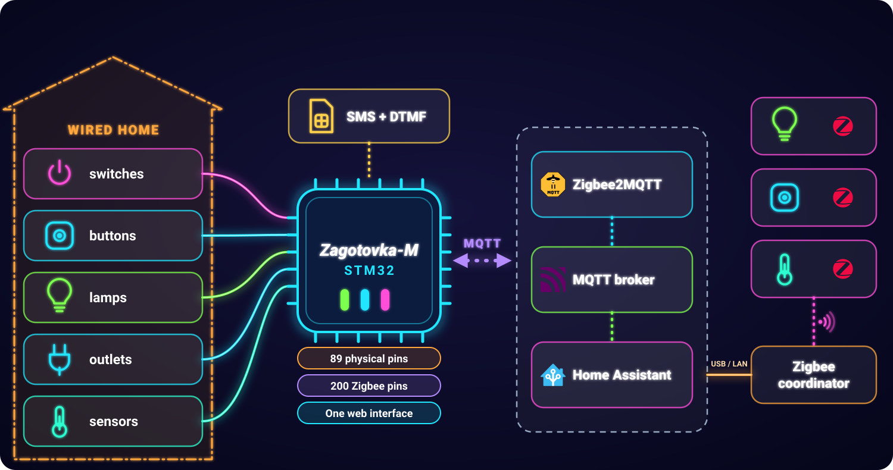

<div align="center">

# Zagotovka-M

### Wired reliability. Wireless flexibility of Zigbee.
### With Zagotovka-M you can build either solution alone or combine both - your smart home gets the most out of their tandem.

**[Русская версия](README_Ru.md)** | **English** | **[Download firmware](https://github.com/zagotovka/Zagotovka_M/releases/latest)** | **[Video guides](#interface-video-guide)**


<!-- GIF 1 (hero): short loop of the web interface - toggling a lamp, a Zigbee button press, a slider -->
<!--  -->

</div>

> **Experimental software.** Do not use it in critical systems. Use at your own risk (full legal text at the bottom of this page).

## What is it?

Zagotovka-M is firmware for a **NUCLEO-F767ZI** board that turns it into a smart home controller. The project fits both **wired automation** and systems built **entirely on wireless Zigbee devices**.

In the wired setup you can connect up to **89 physical pins** for wall switches, buttons, relays, PWM dimmers, encoders and temperature sensors. In the wireless scenario **200 virtual slots** are available for Zigbee devices: lamps, buttons, sensors, relays and other peripherals.

Wired and wireless devices live in one system and can interact with each other: a wall switch turns on a Zigbee lamp, a Zigbee button toggles a wired relay, and an automation can dim the lights at sunset.

By combining the reliability of a wired solution with the flexibility and extensibility of Zigbee, you get the most out of both approaches under one "roof" - in a single smart home control system.

Everything is set up in a browser. No code, no YAML, no compiling.

## How it works



The wired part works on its own, with no network services at all. For the wireless part the controller talks to the outside world through a single standard channel: **MQTT**. That is why it fits into almost any setup:

- **Zigbee gateway or coordinator.** Any model that Zigbee2MQTT supports (SLZB, USB sticks, Ethernet, Wi-Fi or serial adapters). Zagotovka-M does not care which one you have.
- **Zigbee2MQTT.** Installed on a separate machine: Orange Pi, Raspberry Pi, Docker, NAS, or next to Home Assistant. The controller learns the capabilities of every device from Zigbee2MQTT by itself.
- **Home Assistant.** Installed anywhere on your network. The controller publishes its switches, lights, sensors and buttons through [MQTT Discovery](https://github.com/zagotovka/Zagotovka_M/commit/71c61772975126c5fee4b2aa127eb2abeac606f2), and they appear in Home Assistant without any manual setup.

Zigbee2MQTT, the MQTT broker and Home Assistant can all run together on one single-board computer such as an Orange Pi 3 or a Raspberry Pi (this is how the author runs it), or on separate machines. It is up to you.

**You only enter the addresses on the Global Settings page** (MQTT broker, Zigbee2MQTT, Home Assistant, coordinator). After that the controller connects to everything and starts working. Moved Home Assistant to another server? Change one address and you are done.

<!-- GIF 2: Global Settings page - typing the broker address, indicators HA / Z2M turn green -->
<!--  -->

Prefer no Zigbee2MQTT at all? **Hub mode** lets an SLZB-06p7U gateway connect directly to the built-in MQTT broker of the controller.

## Why you will like it

| | |
|---|---|
| **Wired + Zigbee in one list** | Physical pins and Zigbee devices are shown on the same pages and linked with a simple action such as `6:2` (toggle device 6). |
| **Three gestures per button** | Single click, double click and long press, each with its own action. Works for wired and Zigbee buttons. |
| **Smart conditions** | Actions can have conditions, for example "do not turn on at night" (`6:1?R2&!R3`), with a shared library of 12 conditions. |
| **Learns Zigbee devices** | Press a button or move a dimmer in learning mode and the controller works out what the device can do. |
| **Home Assistant in one click** | MQTT Discovery publishes switches, PWM lights, DS18B20 and DHT22 sensors, button and security triggers. |
| **Timers, PID, sensors** | Cron-like timers with sunrise and sunset, PID controller, PWM and encoders, 1-Wire sensors. |
| **Control from anywhere** | Phone-friendly web interface, HTTPS, SMS and DTMF control through a GSM module, a Remote control page with everything on one screen. |
| **Safe updates** | Dual-bank flash with OTA update from the browser; the bootloader checks the image and rolls back on error. |

<!-- GIF 3: wall switch click -> Zigbee lamp turns on; button double click -> scenario -->
<!--  -->

## Why not ESP32 / ESPHome?

Zagotovka-M is built so that one controller serves the whole house: in the wired setup that is 89 physical pins (24 of them with hardware PWM), and in the wireless one 200 Zigbee device slots in the same system. An ESP32 has far fewer usable GPIOs, so for the wired part you would have to split the system into several nodes or add port expanders. The controller connects over Ethernet and does not use Wi-Fi at all, because the goal is reliability. All the logic (pin links, timers, conditions, PID, encoders) is configured in the browser and takes effect immediately, with no YAML and no reflashing. In ESPHome the configuration is compiled into the firmware, so every change to a scenario means a rebuild. The wired part works on its own, without Home Assistant or any cloud. The firmware still includes an MQTT broker, HTTPS, SMS and DTMF control through a GSM module, and network updates with a dual-bank flash and rollback on error. The STM32F767, with 2 MB of flash and 512 KB of RAM, fits these tasks better. Ethernet, USB and a debugger already come on the ready-made NUCLEO-F767ZI board, so all that is left is to add simple adapter boards (Gerber files are provided below).

None of this means ESP32 is worse. For standalone Wi-Fi nodes ESPHome is still an excellent choice, and such devices connect to Zagotovka-M easily through MQTT.

## Quick start

1. **Build or buy the board.** See [What to buy](#what-to-buy) and the wiring notes for electricians below.
2. **Flash the firmware.** Follow [Download firmware and how to flash STM32](#download-firmware-and-how-to-flash-stm32). One program does the whole first flash for you.
3. **Open the web interface** and go to **Global Settings**. Enter the address of your MQTT broker, Zigbee2MQTT and Home Assistant.
4. **Add devices.** Pick a pin on the **Select pin(s)** page, choose its type (switch, button, Zigbee...) and link it to what it should control.
5. **Watch the video guides** below for every page.

Requirements for the integrations: in Zigbee2MQTT set `homeassistant: enabled: true` (the controller learns device names from it); Home Assistant 2025.10 or newer is needed for the predefined entity ids.

---

### Information for electricians: <a href="https://youtu.be/dl3f8Jo28ps"></a>&nbsp;&nbsp;<a href="https://rutube.ru/video/a7eb1218174d5f78254775de943bdcde/"></a>
The wiring scheme using junction boxes is NOT suitable for this project!

<p float="left">
  <a href="/icons/provoda_OLD.png" target="_blank">
    
  </a>
  <a href="/icons/OLD_sxema.png" target="_blank">
    
  </a>
</p>

### Direct wiring is required:
From each point (outlet, switch, ceiling lamp, etc.) directly to the electrical panel!

<p float="left">
<a href="/icons/provoda_NEW.png" target="_blank">
  
</a>
<a href="/icons/New_sxema.png" target="_blank">
    
  </a>
</p>

## What to buy:
1. [](https://aliexpress.ru/wholesale?SearchText=NUCLEO-F767ZI&g=y&page=1) NUCLEO-F767ZI
2. [](https://aliexpress.ru/wholesale?SearchText=GSM+Module+SIM800L&g=y&page=1) GSM Module SIM800L
3. [](https://aliexpress.ru/wholesale?SearchText=Jumper+cap+2.54&g=y&page=1) Jumper cap 2.54
4. [](https://aliexpress.ru/wholesale?SearchText=10pcs+2.54MM+pitch+MALE+SOCKET+straight+idc+box+headers+&g=y&page=1) 20P and 5P 2.54mm
5. [](https://aliexpress.ru/wholesale?SearchText=10+%D1%88%D1%82.+2%252C54+%D0%BC%D0%BC+80+Pin+%D1%88%D0%B0%D0%B3+%D1%88%D1%82%D1%8B%D1%80%D0%B5%D0%B2%D0%BE%D0%B9+%D0%B4%D0%B2%D1%83%D1%85%D1%80%D1%8F%D0%B4%D0%BD%D1%8B%D0%B9&g=y&page=1) 2 pcs. 2.54mm 80 Pin male dual-row header
6. [](https://aliexpress.ru/wholesale?SearchText=%D0%9A%D0%BB%D0%B5%D0%BC%D0%BC%D0%BD%D0%B0%D1%8F+%D0%BA%D0%BE%D0%BB%D0%BE%D0%B4%D0%BA%D0%B0+KF301-+2+P&g=y&page=1) Terminal block KF301-2P
7. [](https://aliexpress.ru/item/1005008062387765.html) Dual-row connector FC-6P and FC-20P 2.54mm
8. [](https://aliexpress.ru/wholesale?SearchText=%D0%9F%D0%BB%D0%BE%D1%81%D0%BA%D0%B8%D0%B9+%D0%BB%D0%B5%D0%BD%D1%82%D0%BE%D1%87%D0%BD%D1%8B%D0%B9+%D0%BA%D0%B0%D0%B1%D0%B5%D0%BB%D1%8C+%D0%B4%D0%BB%D1%8F+IDC+2%252C0+%D0%BC%D0%BC+FC+&g=y&page=1) Flat ribbon cable for IDC FC connector 2.54mm 40P and 12P
9. [](https://aliexpress.ru/wholesale?SearchText=resistor&g=y&page=1) Resistors 2.2K 90pcs. and 10K 90pcs.
10. [](https://aliexpress.ru/wholesale?SearchText=%D0%9A%D0%B0%D0%B1%D0%B5%D0%BB%D1%8C-%D0%BF%D0%B5%D1%80%D0%B5%D1%85%D0%BE%D0%B4%D0%BD%D0%B8%D0%BA+%D1%81+Micro+USB+%D0%BD%D0%B0+OTG&g=y&page=1) Micro USB 5Pin male to USB adapter cable
11. [](https://aliexpress.ru/wholesale?SearchText=DC-DC+Buck+Converter+4.5V-16V+9V+12V+to+5V+3.3V+Step-down+Power+Voltage+Regulator+Module+Efficiency+98%25&g=y&page=1) DC-DC converter
12. [](https://aliexpress.ru/wholesale?SearchText=%D0%A2%D0%B2%D0%B5%D1%80%D0%B4%D0%BE%D1%82%D0%B5%D0%BB%D1%8C%D0%BD%D1%8B%D0%B9+%D1%80%D0%B5%D0%BB%D0%B5%D0%B9%D0%BD%D1%8B%D0%B9+%D0%BC%D0%BE%D0%B4%D1%83%D0%BB%D1%8C&g=y&page=1) Solid-state relay module
13. [](https://aliexpress.ru/wholesale?SearchText=2.54mm+Double+Row+Straight+Female+2-40P&g=y&page=1) Dual-row female connector
### Gerber files: <a href="https://youtu.be/3tv2-pYXrjg"></a>&nbsp;&nbsp;<a href="https://rutube.ru/video/private/9b2cea71a3b7a72765657751a905738c/?p=SsnMQCw9kL5LmihFU1ot_Q"></a>
a. <a href="https://easyeda.com/editor#id=|e6a461cf7da546748c711f5ae1138cd7|2ffd4d2211de4b4ba91e1188545134c2" target="_blank">Zagotovka</a><br>
b. <a href="https://easyeda.com/editor#id=|23ee55cfd3e24ca19753cbba7066c13f|d1e252ee42ab4fbfb84c61a65fa2982f" target="_blank">Zagotovka-CN11</a><br>
c. <a href="https://easyeda.com/editor#id=|7e31c289e9f742a2acfa7db54bbde58a|30d6a426a32f425b8c8ff5ba5bdb792b" target="_blank">Zagotovka-CN12</a><br>
d. <a href="https://easyeda.com/editor#id=|125ff34d97324d308c97b01793449de7|1bc69b35cc6d419080bf3461774739e3" target="_blank">Zagotovka-10</a>

## Optional purchases:
15. [](https://aliexpress.ru/wholesale?SearchText=%D0%AD%D0%BD%D0%BA%D0%BE%D0%B4%D0%B5%D1%80&g=y&page=1) Encoder
16. [](https://aliexpress.ru/wholesale?SearchText=%D0%9F%D1%80%D0%BE%D0%B2%D0%BE%D0%B4%D0%BD%D0%BE%D0%B9+%D0%BC%D0%B0%D0%B3%D0%BD%D0%B8%D1%82%D0%BD%D1%8B%D0%B9+%D0%B4%D0%B2%D0%B5%D1%80%D0%BD%D0%BE%D0%B9%2C+%D0%BE%D0%BA%D0%BE%D0%BD%D0%BD%D1%8B%D0%B9+%D0%BA%D0%BE%D0%BD%D1%82%D0%B0%D0%BA%D1%82%D0%BD%D1%8B%D0%B9+%D0%B3%D0%B5%D1%80%D0%BA%D0%BE%D0%BD&g=y&page=1) Reed switch
17. [](https://aliexpress.ru/wholesale?SearchText=ds18b20&g=y&page=1) DS18B20
18. [](https://aliexpress.ru/wholesale?SearchText=dht22&g=y&page=1) DHT22
19. [](https://aliexpress.ru/wholesale?SearchText=TTP223&g=y&page=1) TTP223
20. [](https://aliexpress.ru/wholesale?SearchText=%D0%9A%D0%B0%D0%B1%D0%B5%D0%BB%D1%8C+Dupont+Line+%D0%B4%D0%BB%D1%8F+Arduino&g=y&page=1) Arduino jumper wires

### Assembly and connection. <a href="https://youtu.be/0MEFwOGv__A"></a>&nbsp;&nbsp;<a href="https://rutube.ru/video/b01398d510e53b7798d8fa7cf06d6fbc/"></a>

## [Download firmware](https://github.com/zagotovka/Zagotovka_M/releases/latest) and how to flash STM32? <a href="https://youtu.be/C4c-W71eqqY"></a>&nbsp;&nbsp;<a href="https://rutube.ru/video/55e08612c6f4ec527f6d10fa24ae89fb/"></a>

The project now uses a dual-bank (Bank A / Bank B) flash layout. For a first-time flash, download and program the Bank A image; Bank B is used for subsequent OTA updates. Both current firmware images are also available in the [Proshivka](https://github.com/zagotovka/Zagotovka_M/tree/main/Proshivka) folder.

### First flash of a new board (Windows, macOS, Linux)

A brand-new STM32 chip has its memory set up in the "single" way. Zagotovka_M needs the "dual" way (it is called **Dual Bank**, the option `nDBANK = 0`). The firmware cannot change this by itself: when the memory mode changes, everything stored in the chip is destroyed, including the bootloader. So the mode is changed from the outside, **before** the firmware is written.

You do not have to do it by hand. The program `make_first_flash` does everything in one run:

1. It takes the bootloader and the newest Bank A firmware from this repository on GitHub (the version is read from the `VERSION` file), or from the project folder if it finds one next to the program, and builds one file `Zagotovka_FIRST_FLASH_<version>.bin` (the bootloader + the Bank A firmware).
2. It asks the chip which memory mode it has.
3. If the chip is in the old ("single") mode, it switches it to Dual Bank and waits until the chip restarts (up to 40 seconds, usually much less).
4. It erases the whole chip, writes the file and checks that the data was written correctly.
5. It prints `DONE`.

If something is wrong (a file is missing, the chip is not connected), the program stops and says why, before it touches the chip.

**How to run it:**

1. Download the whole project: on the [project page](https://github.com/zagotovka/Zagotovka_M) click "Code" -> "Download ZIP" and unpack the archive (on Windows: right click -> "Extract All").
2. In the unpacked project open the folder `Proshivka/First_flash/<your system>` (`Windows`, `Linux`, `MAC/Mac_Intel` or `MAC/Mac_Apple_Silicon`) and unpack the archive that lies there. The program finds the bootloader and the firmware files of the project by itself, so no internet connection is needed.
3. Connect the board to the computer with a USB cable (the ST-LINK connector).
4. Open a terminal in the folder with the unpacked program and run it:
   - Windows: in Explorer open the unpacked folder, type `powershell` in the address bar, press Enter and run `.\make_first_flash.exe` (double-clicking the file also works).
   - Linux: run `chmod +x make_first_flash`, then `./make_first_flash`.
   - macOS: run `xattr -d com.apple.quarantine make_first_flash` once (the system blocks files downloaded from the internet), then `chmod +x make_first_flash` and `./make_first_flash`. Choose the folder for your processor: `Mac_Apple_Silicon` for Apple Silicon (M1 and newer) or `Mac_Intel` for Intel Macs. To check, open the Apple menu, then "About This Mac" and look at the "Chip" or "Processor" line.

After `DONE` the board restarts by itself and starts the firmware; the terminal must show `[BOOT] Flash: Dual Bank (OK)`. If you only want to build the file and not touch the chip, run the program with `--image-only`; all options are shown by `--help`.

If you start the program outside the project folder, it downloads the bootloader and the newest Bank A firmware from GitHub into the temporary folder of the computer (the system cleans it later). Without internet it then uses the files it downloaded earlier and the bootloader built into it, and the Bank A `.bin` file has to be given with `--bank-a` (or dragged onto the program), for example `.\make_first_flash.exe --offline --bank-a "C:\path\Zagotovka_Bank_A_v<version>.bin"`. To flash a fixed version instead of the newest one, add `--ref <tag>` (any tag or branch of the repository).

> Do not just drag the `FIRST_FLASH` file onto the `NODE_F767ZI` USB drive of a brand-new board. Dragging a file does not change the memory mode, so the bootloader would print an error and would not start the firmware. Use the program above.

**Two things that depend on the operating system, not on the program:**

- **Windows.** The WinUSB driver for ST-LINK is needed. Without it the program says `The debug probe could not be created`. Download "ST-LINK USB driver" ([STSW-LINK009](https://www.st.com/en/development-tools/stsw-link009.html)) from the official ST site, unpack the archive, run `stlink_winusb_install.bat` as administrator and plug the board in again. This is done once per computer.
- **Windows, "Windows protected your PC".** The program is not signed yet, so SmartScreen warns about an unknown publisher. Click "More info", then "Run anyway". If Windows 11 instead shows "Smart App Control blocked an app" with only an "Okay" button, that protection cannot be bypassed for a single program: it lets an unsigned program run only if Microsoft's cloud service considers it safe. You can turn Smart App Control off in Windows Security (App & browser control, Smart App Control settings) for the time of flashing and turn it on again afterwards. On older Windows 11 builds the "On" option is unavailable after it was switched off; update Windows first, and if it is still unavailable, use the registry (command prompt as administrator, then restart the computer or run `CiTool.exe -r`): `reg add "HKLM\SYSTEM\CurrentControlSet\Control\CI\Policy" /v VerifiedAndReputablePolicyState /t REG_DWORD /d 1 /f` turns it on, `/d 2` turns on evaluation mode, `/d 0` turns it off. This method is not offered in the Windows settings, so use it at your own risk.
- **Linux.** If the program says that it does not see the ST-LINK, but on another computer everything works, then your user has no right to use the USB device. Install the package with the `udev` rules (Debian/Ubuntu: `sudo apt install stlink-tools`, Arch: `sudo pacman -S stlink`, Fedora: `sudo dnf install stlink`) and plug the board in again. macOS needs no driver.

## Interface video guide.

### How to use the "Switches" page <a href="https://youtu.be/C74IQA4-2aI"></a>&nbsp;&nbsp;<a href="https://rutube.ru/video/2d1cbc007f3da4553a70387ba9ce4421/"></a>
### How to use the "Buttons" page <a href="https://youtu.be/pMmqkwCnVaM"></a>&nbsp;&nbsp;<a href="https://rutube.ru/video/b3336efe85e3811c379922c55f8c6e0f/"></a>
### How to use the "Encoders" page (under development) <a href="https://youtu.be/mRENaW0x7i8"></a>&nbsp;&nbsp;<a href="https://rutube.ru/video/2289862620f6aff184af8c90487910ff/"></a>
### How to use the "Timers" page <a href="https://youtu.be/8pgqBO4cKdg"></a>&nbsp;&nbsp;<a href="https://rutube.ru/video/1268e322b1618adb77710be2fff14bf2/"></a>
### How to use the "OneWire" page <a href="https://youtu.be/FTfkruXgUT0"></a>&nbsp;&nbsp;<a href="https://rutube.ru/video/11652a191dc348f2218f202b141a8c76/"></a>
### How to use the "Security" page <a href="https://youtu.be/N9od6Ji41jU"></a>&nbsp;&nbsp;<a href="https://rutube.ru/video/0043b0287f85fee9c82f10104955ec85/"></a>
### How to set up "HTTPS" for remote management from anywhere in the world. <a href="https://youtu.be/w-ke9_BD0vk"></a>&nbsp;&nbsp;<a href="https://rutube.ru/video/9899433b2f574b507cda7e50bfcd342b/"></a>
### [Download 'CertGeneration.sh'](https://github.com/zagotovka/Zagotovka_M/raw/main/scripts/CertGeneration.sh) for certificate generation (right-click and select "Save link as").
### Dangerous bug that can lead to fatal consequences! <a href="https://youtu.be/F0R1ltD-ztE"></a>&nbsp;&nbsp;<a href="https://rutube.ru/video/1d4476ca90e75804371516bbc6726cdd/"></a>

## For developers

### Information for frontend developers
Everything you need is in the "web_root" folder. [go to web_root](https://github.com/zagotovka/Zagotovka_M/tree/main/web_root)
To install and run the web interface with Vite (Debian):
```bash
sudo apt update
sudo apt install nodejs npm
npm init -y
rm -rf node_modules
npm install
npm install preact-router
npm install history
npm run start
```

### Information for backend developers
- STM32CubeIDE Version: 1.15.1
- FREERTOS Version: V10.2.1 CMSIS_V2
- Mongoose Version: 7.21


<details>
<summary>Disclaimer (legal text)</summary>

SPDX-License-Identifier: GPL-2.0-only or commercial

## Warning:
This software is experimental and a work in progress. Under no circumstances should these files be used in relation to any critical system(s). Use of these files is at your own risk. THE SOFTWARE IS PROVIDED "AS IS", WITHOUT WARRANTY OF ANY KIND, EXPRESS OR IMPLIED, INCLUDING BUT NOT LIMITED TO THE WARRANTIES OF MERCHANTABILITY, FITNESS FOR A PARTICULAR PURPOSE AND NONINFRINGEMENT. IN NO EVENT SHALL THE AUTHORS OR COPYRIGHT HOLDERS BE LIABLE FOR ANY CLAIM, DAMAGES OR OTHER LIABILITY, WHETHER IN AN ACTION OF CONTRACT, TORT OR OTHERWISE, ARISING FROM, OUT OF OR IN CONNECTION WITH THE SOFTWARE OR THE USE OR OTHER DEALINGS IN THE SOFTWARE.

## Внимание:
Данное программное обеспечение является экспериментальным и находится в стадии разработки. Ни при каких обстоятельствах эти файлы не должны использоваться в отношении любой критически важной системы (систем). Использование этих файлов осуществляется на ваш страх и риск. ПРОГРАММНОЕ ОБЕСПЕЧЕНИЕ ПРЕДОСТАВЛЯЕТСЯ «КАК ЕСТЬ», БЕЗ КАКИХ-ЛИБО ГАРАНТИЙ, ЯВНЫХ ИЛИ ПОДРАЗУМЕВАЕМЫХ, ВКЛЮЧАЯ, НО НЕ ОГРАНИЧИВАЯСЬ, ГАРАНТИЯМИ ТОВАРНОГО СОСТОЯНИЯ, ПРИГОДНОСТИ ДЛЯ КОНКРЕТНОЙ ЦЕЛИ И НЕНАРУШЕНИЯ ПРАВ. НИ ПРИ КАКИХ ОБСТОЯТЕЛЬСТВАХ АВТОРЫ ИЛИ ПРАВООБЛАДАТЕЛИ НЕ НЕСУТ ОТВЕТСТВЕННОСТИ ЗА ЛЮБЫЕ ПРЕТЕНЗИИ, УБЫТКИ ИЛИ ДРУГИЕ ОБЯЗАТЕЛЬСТВА, БУДЬ ТО ДОГОВОРНЫЕ, ГРАЖДАНСКО-ПРАВОВЫЕ ИЛИ ИНЫЕ, ВОЗНИКАЮЩИЕ ИЗ, ИЗ ИЛИ В СВЯЗИ С ПРОГРАММНЫМ ОБЕСПЕЧЕНИЕМ, ИСПОЛЬЗОВАНИЕМ ИЛИ ИНЫМИ ДЕЙСТВИЯМИ С ПРОГРАММНЫМ ОБЕСПЕЧЕНИЕМ

</details>

## Versioning and history

## Versioning and history

<details>

<summary>Versioning system</summary>

<small>
This project uses semantic versioning. The version number follows the MAJOR.MINOR.PATCH format.

### Version components explained

#### MAJOR (first number)
- Increased for incompatible changes
- Example: changing from 1.x.x to 2.0.0 means significant changes that may break existing functionality

#### MINOR (second number)
- Increased when adding new functionality while maintaining backward compatibility
- Reset when MAJOR version increases
- Example: changing from 1.1.x to 1.2.0 means new features without breaking existing ones

#### PATCH (third number)
- Increased when fixing bugs that don't affect core functionality
- Reset when MAJOR or MINOR version increases
- Example: changing from 1.1.1 to 1.1.2 means fixing minor bugs
</small>

</details>

### Version history

| Version | Date       | Description               |
|---------|------------|---------------------------|
| 1.0.0   | 11-01-2025 | First stable release.|
| 1.0.1   | 3-02-2025 | Fixed bugs in "StartCronTask" and "ModalEditSensor".|
| 1.1.1   | 4-04-2025 | Added HTTPS support (HTTPS server implementation)|
| 2.0.0   | 27.06.2026 | Updated web interface and Mongoose library (7.13 → 7.21); added: SMS control, session limiting with indication, PID controller, PWM timer, desired encoder PWM frequency setting (0.05 Hz — 2 MHz); optimized and refactored code |
| 2.0.1 | 30.06.2026 | Replaced cJSON with Mongoose's built-in JSON API, heap optimization, and MQTT fix.|
| 2.0.2 | 02-07-2026 | Implemented: stop TLS Alert storm in pollQueue on session invalidation.|
| 2.1.0 | 15-07-2026 | Added Zigbee integration via MQTT gateway (SLZB-06p7U).|
| 2.1.1 | 17-07-2026 | Added DTCM pool allocator; migrated ~57 KB of buffers from .bss.|
| 2.2.0 | 18-07-2026 | Added universal Zigbee dimmer → encoder PWM binding with auto-detected range.|
| 2.2.1 | 19-07-2026 | Placed 42 hot functions in ITCM RAM for deterministic execution.|
| 2.2.2 | 20-07-2026 | Fixed Zigbee switch connection persistence, dimmer calibration, and learning mode.|
| 2.3.0 | 22-07-2026 | Added cascade deletion of connections when a pin type is set to NONE.|
| 2.4.0 | 24-07-2026 | Added universal Zigbee button support with auto-release and flexible payload matching.|
| 2.4.1 | 25-07-2026 | Fixed button event filtering, Zigbee PASSTHROUGH val:0 handling, and structured logging.|
| 2.5.0 | 31-07-2026 | Implemented OTA firmware update.|
| 2.5.1 | 01-08-2026 | Fixed a hardware bug with Flash memory lock.|
| 2.6.0 | 17-08-2026 | Implemented Dual Bank mode (dual-bank flash).|
| 2.6.1 | 07-09-2026 | Protected ITCM with MPU; fixed a NULL stdout write that corrupted ITCM.|
| 2.6.2 | 11-09-2026 | Added validation that the .bin firmware matches the inactive bank.|
| 2.7.0 | 13-09-2026 | Implemented a built-in MQTT server.|
| 2.8.0 | 14-09-2026 | Added live SYSTEM LOG tail to the Dashboard; embedded firmware version in release .bin file names.|
| 2.9.0 | 28-09-2026 | Raised the pin-to-pin link limit from 100 to 1024; fixed Zigbee ID truncation (IDs above 255) and out-of-bounds reads; links API now streamed in chunks; moved link storage from the DTCM pool to .bss.|
| 2.9.1 | 29-09-2026 | Fixed: empty INFO field could not be cleared; "Save changes" in Edit switch/Connection (also buttons, encoders) no longer turns on linked outputs.|
| 2.9.2 | 30-09-2026 | Improved button timing: immediate single-click handling without double-click support, configurable double-click interval via `dcinter`, and more deterministic 5 ms button polling. |
| 2.10.0 | 04-10-2026 | Added action conditions (e.g. `6:1?R2&!R3`) with a library of 12 shared conditions; Condition selector for Switch/Encoder links and PID; over-long actions are rejected, not truncated; Bank A now built with -Os. |
| 2.10.1 | 07-10-2026 | Added a Conditions library panel (C1..C12) with in-place editing, usage counters and warning badges for links to empty cells on the Switch, Encoder and PID pages; added the `D`/`DV` condition letters for device state and dimmer value (`R`/`RV` still work); fixed the Sunrise/Sunset fields rejecting uppercase letters; unified the formatting of all help sections and applied new menu icons. |
| 2.11.0 | 08-10-2026 | Made the web interface usable on phones; added PWM rows without an encoder to the PWM/Encoder pin page (On/Off switch, Normal/Inverted polarity, Zigbee dimmer binding); PWM can be switched by SMS and DTMF; renamed the Encoder pin page and added descriptions to all pages. |
| 2.12.0 | 13-10-2026 | Added a "Copy help" button to the help panel on every page (copies the whole help as Markdown, also works over plain http); the Device Logs page now has a "Show Help" / "Hide Help" button instead of an always-expanded help. |
| 2.12.1 | 13-10-2026 | Fixed OTA updates booting old firmware after successful writes: wrong flash sectors were erased when the 94-slot ring wrapped (now sectors 22–23 in Dual Bank mode, with erase/write verification). Reduced [DIAG] log flooding on the Device Logs page. Bootloader must be reflashed once with a programmer. |
| 2.12.2 | 15-10-2026 | Fixed: PWM pins with ID 30 and above were missing in the PWM timer and PID modals (added the lightweight /api/pwmpins/get request, lower heap peak); the On/Off slider now acts as a master enable for physical and Zigbee buttons; the page reloads to the login screen after an OTA update. A web build error now aborts the firmware build. |
| 2.12.3 | 19-10-2026 | Reduced heap peaks and hardened web UI/API: paginated responses, one request at a time, polling paused during saves. Added /api/pins/get and /api/sensors/get; fixed data loss, field truncation, JSON escaping, and log issues. POSTs return proper 400/507 errors. Firmware upload validates session and Content-Length first; /api/device/eraselast is disabled by default and POST-only. |
| 2.13.0 | 21-10-2026 | Added a per-pin "**State on power-up**" setting (like Tasmota PowerOnState): supports Device/PWM pins and Zigbee, with delayed USB state saving and a responsive column with tooltip. Existing behavior preserved by default. Renamed “Duty on restore” to “Power on state.” |
| 3.0.0 | 25-10-2026 | Shifted the logical ID scheme: physical pins now use IDs 1..89 (was 0..88), Zigbee 90..289 (was 89..288); saved configs are migrated automatically once (idver). IDs in the token API, MQTT, SMS commands and cron strings are shifted by +1. Reviewed every web page. Added an animated Zagotovka Mongoose logo (needs @property support: Chrome 85+, Safari 16.4+, Firefox 128+; older browsers show a static logo). |
| 3.0.1 | 26-10-2026 | OTA/bootloader reliability: bootloader verifies OTA image CRC32 before first trial boot and rolls back on mismatch; normal boot checks only MSP. Both banks’ size/CRC32 are stored in settings. Direct ST-Link flashes are detected and their stale version/CRC reset, showing “flashed directly” on the Firmware Update page. Settings writes are mutex-protected; OTA state survives settings-ring erase. Limitation: corrupted and directly flashed images are indistinguishable by content. One-time reflash of bootloader and erase of settings sectors 22–23 required; TLS key/certificate and Telegram token must be re-entered. |
| 3.0.2 | 27-10-2026 | Wrote the scripts/make_first_flash.py script, which prepares the microcontroller in a single operation, with no repeated runs: it reads FLASH->OPTCR, switches to Dual Bank if necessary (nDBANK=0), waits for the restart, erases the Flash, and programs Zagotovka_FIRST_FLASH_vX.X.Xx.bin (works on Windows, macOS, and Linux; requires STM32CubeProgrammer, which must be installed separately from the official ST website). For devices already running in Dual Bank, the script skips the Dual Bank switch. New boards must be switched to Dual Bank before the first flash (via the script or in CubeProgrammer): simply dragging the file onto the NODE_F767ZI drive does not change the memory mode! |
| 3.1.0 | 30-10-2026 | Added the Remote control page (`/remote`) with switches, PWM, buttons, Zigbee, PID, security and sensors on one screen, powered by paginated `GET /api/state/remote` (ETag/304) and `POST /api/remote/cmd`; hardened the built-in MQTT server and Zigbee power-on, including stale SLZB gateway eviction, cached gateway/client counts and immediate application of the saved power-on state; reworked web help with shared condition tables in `condHelp.js`, shortened examples, corrected 0–100 dimmer scale, mobile home-screen meta tags and about 180 KB smaller `web_root` before Zopfli. |
| 3.1.1 | 31-10-2026 | Fixed: the Remote control page no longer shows a false "no connection" banner (304 counts as a live link, 5xx does not) and the phone vibrates when a locked control is touched; stale OneWire sensor slots are released when a pin type changes and no longer appear on the Remote control page; "State on power-up" no longer writes to USB when no output uses "Last state" or the state is unchanged. |
| 3.1.2 | 04-11-2026 | Web: the stale global tooltip no longer stays visible after hash navigation or scroll (immediate hide on mousedown/hashchange/scroll/Escape, fallback for a detached owner, hide() race fixed) — same fix in all duplicated tabs. Network: sockets accepted on the web ports get an accept timestamp, so idle empty sockets (browser speculative preconnects, Firefox) are now evicted and closed by the watchdog instead of exhausting the 2-per-IP limit and resetting real requests (RST); richer REJECT diagnostics (reason, heap stats, per-IP count) and decoded TLS alerts (client-rejected certificate / cert-key mismatch) in the log. |
| 3.2.0 | 11-11-2026 | Added Home Assistant MQTT Discovery (switches, PWM, DS18B20/DHT22, button and security triggers, `<tx>/status` availability, retained states); the built-in MQTT broker evicts duplicate client-ids and allows 24 subscriptions per client. Memory: WebServerTask stack in DTCM, newlib heap 32→4 KB, DTCM allocations traced. Remote page: HSV color picker and per-field command queue with one retry on 429/503. Zigbee: master-off also blocks dimmer and color, invalid dimmer ranges fall back to 1..254, MQTT button presses work for Zigbee buttons. Web: update-alert contrast, login autofill fix; Mongoose debug logs removed from flash. Guide and dashboards: `scripts/HOME_ASSISTANT.md`, `scripts/zagotovka_dashboard*.yaml`.|
| 3.3.0 | 15-11-2026 | Rebalanced the Flash layout: bootloader area 256→128 KB, Bank A and Bank B grew from 768 to 896 KB each (+256 KB for firmware; Bank B had only 72 bytes left), the settings ring moved to sector 23 (46 slots instead of 94). Removed dead code: the hidden `eraselast` endpoint and button, and the unused demo API `/api/settings/get` and `/set`. **The bootloader and Bank A change addresses, so OTA cannot update existing boards: reflash with `make_first_flash` (full chip erase) and re-enter the settings, TLS key/certificate and Telegram token.** |
| 3.4.0 | 17-11-2026 | Added the Zigbee2MQTT mode: Zigbee slots work through an MQTT broker with Z2M on a separate server (e.g. an Orange Pi) instead of an SLZB gateway. Commands go by IEEE; states and capabilities come from Z2M. The firmware learns each device's friendly name from Z2M Home Assistant discovery (needs `homeassistant: enabled: true`), so renaming in Z2M breaks nothing. Settings: connection diagnostics and a `configuration.yaml` snippet for the coordinator. Select pin: a green/red Z2M badge shows whether the name was received. Rebuilt the `make_first_flash` archives (the old ones rejected images above 768 KB; the bank is 896 KB). |
| 3.4.1 | 18-11-2026 | Fixed: the Home Assistant reachability check no longer causes a "Login attempt failed" notification in HA every 15 seconds (it now requests `/manifest.json`); long Zigbee2MQTT action names (e.g. `color_temperature_move_stop`) are no longer truncated and their aliases match correctly. Web: link indicators (HA/Z2M/CD) got a light-theme glow and a better mobile layout; help blocks in Settings are collapsible. |
| 3.4.2 | 19-11-2026 | Fixed: memory leaks (malformed EC key in TLS, stuck MQTT close) and the condition pool staying frozen after 48 expressions; Zigbee buttons and switches no longer fire several slots at once (full payload names are stored, one slot owns each payload, switches use the same matcher; relearn remotes that had duplicate words). Hardening: HTTP 411 for chunked bodies without Content-Length, startup checks for mutexes, queues, tasks and DTCM. Settings: help hidden by default in Coordinates & Astronomy, "Home Assistant" merged into "HA Discovery". |
